<div align="center">

# 📚 TutorSync

**The offline-first Android app for freelance home tutors.**
Manage students, schedules, attendance, lessons, and billing, all stored securely on your own device.


</div>

---

## 📖 Table of Contents

- [About](#-about)
- [Features](#-features)
- [Screenshots](#-screenshots)
- [Tech Stack](#-tech-stack)
- [Architecture](#-architecture)
- [Database & Cloud](#-database--cloud)
- [Security](#-security)
- [Authentication](#-authentication)
- [Getting Started](#-getting-started)
- [Project Configuration](#-project-configuration)
- [Author](#-author)

---

## 💡 About

Freelance tutors often juggle notebooks, spreadsheets, and chat apps to track classes and fees. **TutorSync** replaces all of that with one app that works **without internet**.

- 🔒 **Private by design:** your data lives in a local SQLite database on your phone.
- 📴 **Always available:** every core feature works offline.
- 🧾 **Billing built in:** from unbilled classes to PDF invoices and receipts.

---

## 🚀 Features

### 👩‍🎓 Students & Subjects

- Student directory with guardian contact details
- Enrolled subjects per student

### 🗓️ Scheduling

- Weekly recurring class schedules
- Easy makeup-class management

### ✅ Attendance & Lesson Tracking

- Daily attendance: **Present**, **Absent**, **Cancelled**
- Private tutor notes, topics covered, and assigned homework

### 💰 Smart Billing & Invoicing

- **Monthly** and **Per-Class** fee agreements
- Automatic calculation of unbilled classes and outstanding balances
- Itemized **PDF invoices** and **payment receipts**, generated on-device

### 💳 Payments & Ledger

- Record partial or full payments via **Cash, bKash, Nagad, or Bank Transfer**
- Handle refunds and corrections

### 🔐 Security & Backup

- **App Lock** with PIN or Biometric (fingerprint)
- Manual encrypted backups (**AES-256-GCM**, chunked) to local storage or private Google Drive AppData

### 🎨 Personalization

- English and Bangla (বাংলা) localization
- Light and Dark themes

---

## 📱 Screenshots

### 🚪 Onboarding & Authentication

<table>
<tr><td align="center">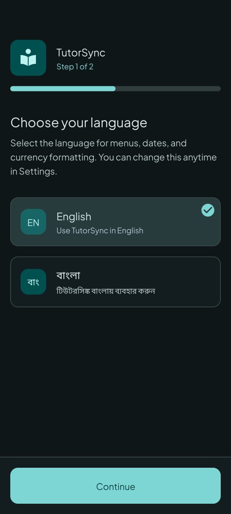<br><sub>Welcome 1</sub></td><td align="center">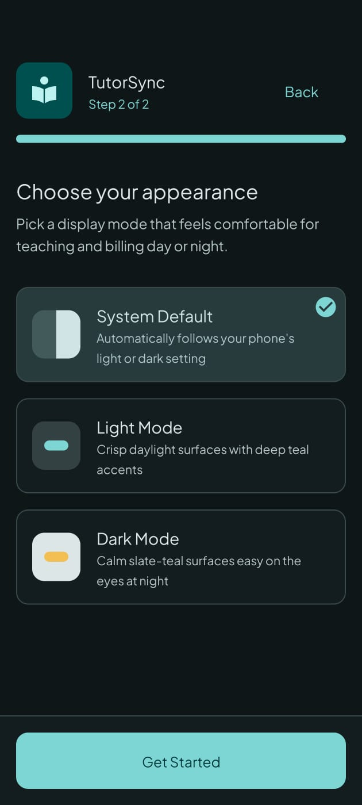<br><sub>Welcome 2</sub></td><td align="center">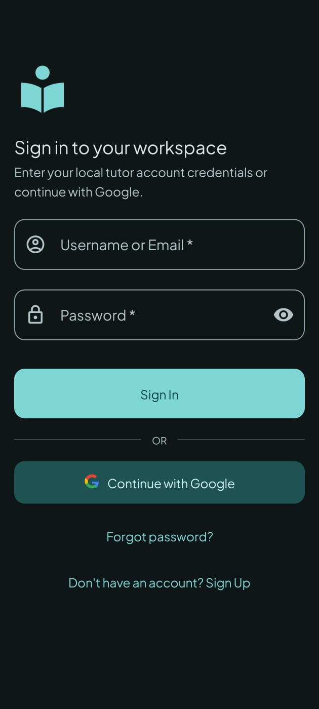<br><sub>Sign In</sub></td><td align="center">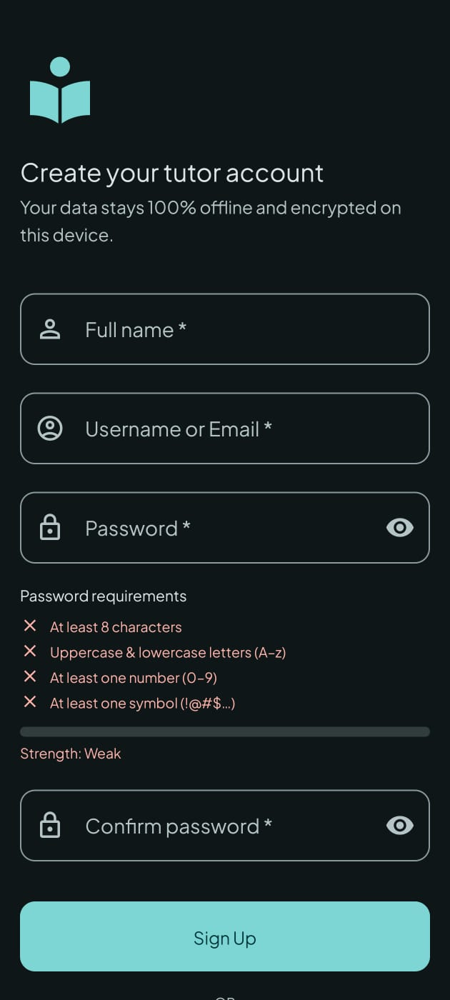<br><sub>Sign Up</sub></td></tr>
</table>

### 🏠 Dashboard, Students & Schedules

<table>
<tr><td align="center">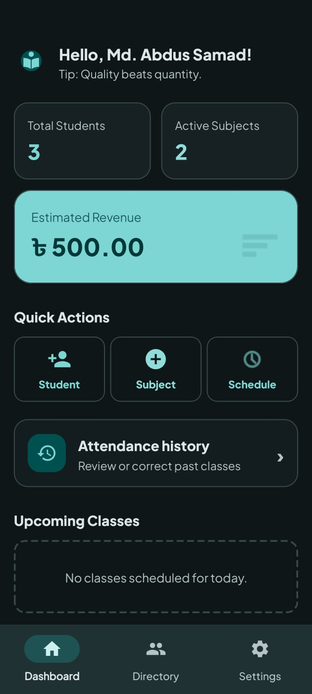<br><sub>Dashboard</sub></td><td align="center">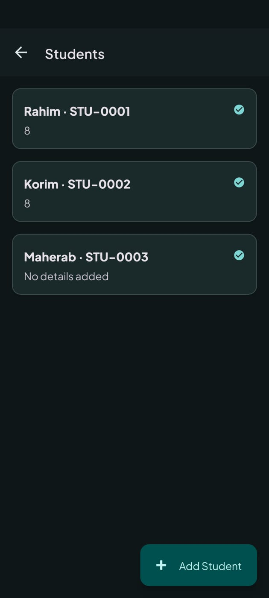<br><sub>Student Directory</sub></td><td align="center">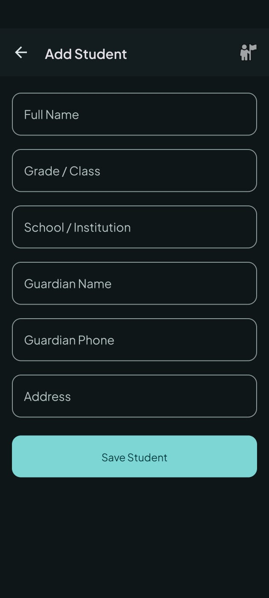<br><sub>Add Student</sub></td><td align="center">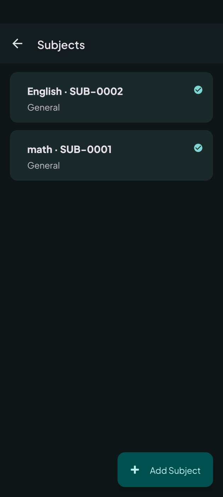<br><sub>Subjects</sub></td></tr>
<tr><td align="center">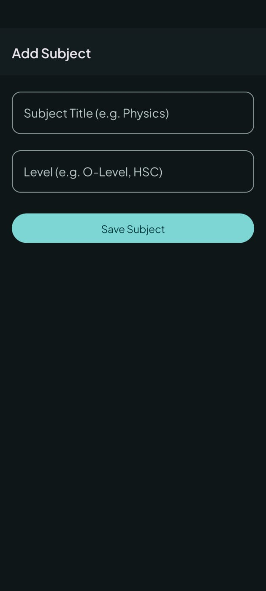<br><sub>Add Subject</sub></td><td align="center">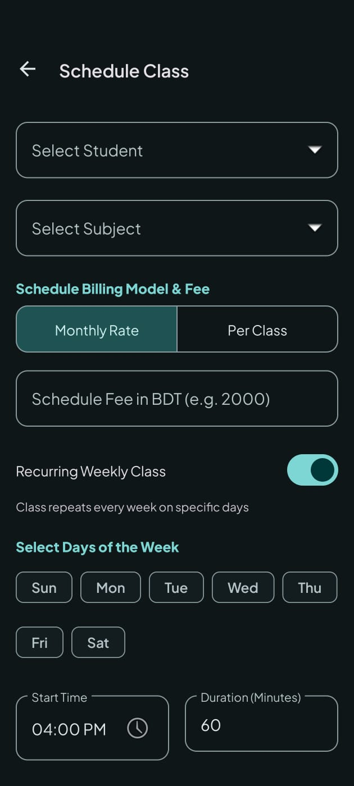<br><sub>Weekly Schedules</sub></td></tr>
</table>

### 💰 Fees & Invoices

<table>
<tr><td align="center"><br><sub>Manage Fee</sub></td><td align="center">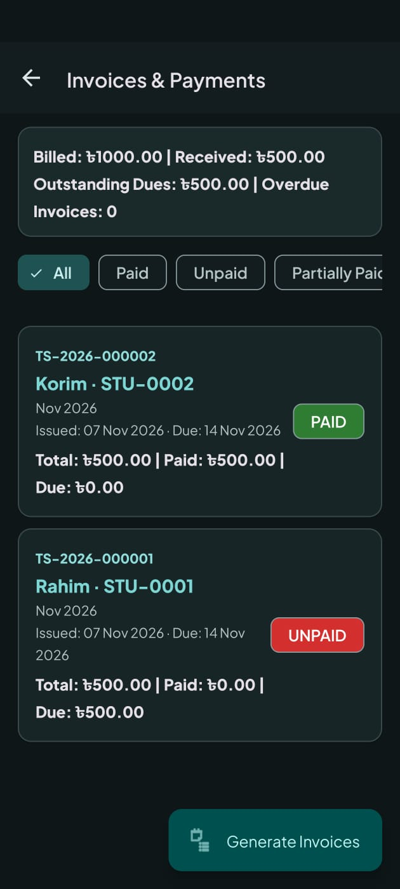<br><sub>Invoice Detail</sub></td></tr>
</table>

### ⚙️ Profile & Settings

<table>
<tr><td align="center">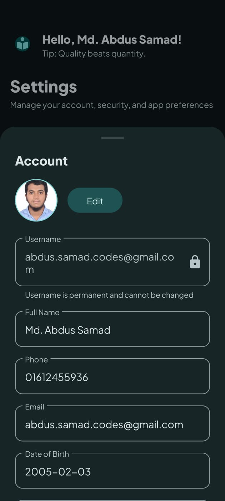<br><sub>Edit Profile</sub></td><td align="center">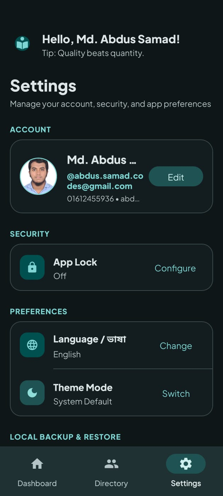<br><sub>Settings 1</sub></td><td align="center">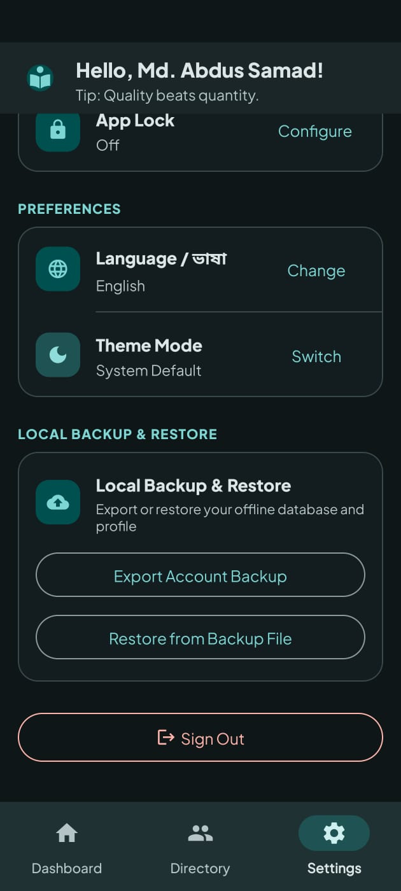<br><sub>Settings 2</sub></td></tr>
</table>

---

## 🛠 Tech Stack

| Area                      | Technology                                                             |
| ------------------------- | ---------------------------------------------------------------------- |
| **Language**              | Java 17                                                                |
| **UI**                    | Android XML, Material Design 3, View Binding                           |
| **Local Database**        | SQLite via `SQLiteOpenHelper`                                          |
| **Authentication**        | Firebase Authentication, Google Identity Services                      |
| **Live Presence**         | Firebase Realtime Database (online/offline status)                     |
| **Account Metadata Sync** | Cloud Firestore (lightweight: account info and student/subject counts) |
| **Cloud Backup**          | Google Drive API (REST v3), hidden `drive.appdata` scope               |
| **Background Work**       | Custom `AppExecutors` thread pools for DB and file I/O                 |

---

## 🏗 Architecture

TutorSync uses a **repository-driven architecture** adapted for offline-first apps.

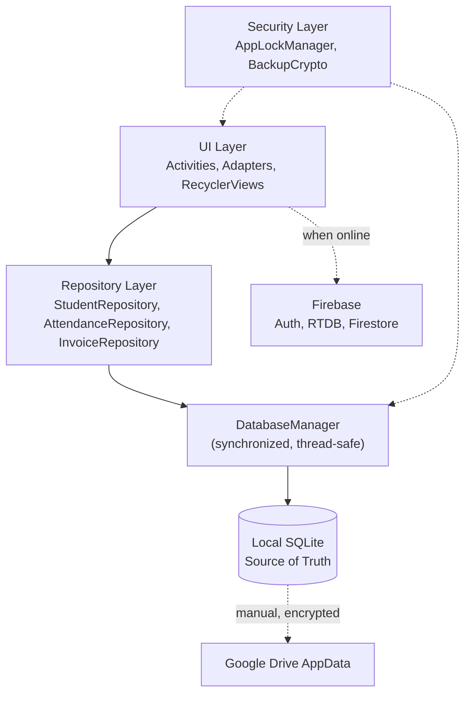

| Layer          | Responsibility                                                                  |
| -------------- | ------------------------------------------------------------------------------- |
| **UI**         | Activity lifecycle, RecyclerViews, Material components                          |
| **Repository** | Hides raw SQLite; exposes clean APIs and complex SQL joins                      |
| **Database**   | `TutorSyncContract` defines schemas; `DatabaseManager` gives thread-safe access |
| **Security**   | `AppLockManager` handles sessions; `BackupCrypto` encrypts exports              |

---

## 🗄 Database & Cloud

- **Local SQLite is the single source of truth.** Students, schedules, transactions, and invoices all live on the device, so the app is 100% functional offline.
- **Firebase runs in the background** (only when online) to log session presence and mirror minimal account state. It never touches your local data integrity.
- **Google Drive AppData** lets you manually push an encrypted copy of your database. The folder is hidden, uses no visible Drive space, and is inaccessible to other apps.

---

## 🔒 Security

| Feature               | Details                                                            |
| --------------------- | ------------------------------------------------------------------ |
| **App Lock**          | PIN or Biometric (fingerprint)                                     |
| **Backup Encryption** | AES-256-GCM, chunked                                               |
| **Data Location**     | Local device first; cloud backup is manual and opt-in              |
| **Cloud Scope**       | `drive.appdata` only, so the app cannot see your other Drive files |

---

## 🔑 Authentication

Built for reliability even without internet.

- **Email & Password:** Firebase Authentication with a local SQLite fallback, so you can log in offline if you have signed in before.
- **Google Sign-In:** one-tap login using Google Identity Services.
- **Password Recovery:** Firebase reset emails, mapped safely to the offline database.

---

## ⚙️ Getting Started

### Prerequisites

- Android Studio **Ladybug** or newer
- JDK 17
- A device or emulator running **Android 8.0 (API 26)+**
- A Google account for Firebase

### Setup

1. **Clone the repository**

   ```bash
   git clone https://github.com/abdussamadcodes/TutorSync.git
   cd TutorSync
   ```

2. **Open in Android Studio** and let it index the project.

3. **Configure Firebase**
   - Create a project in the [Firebase Console](https://console.firebase.google.com/).
   - Enable **Authentication** (Email/Password and Google), **Realtime Database**, and **Cloud Firestore**.
   - Register the Android app with its package name, and add your debug **SHA-1** fingerprint (needed for Google Sign-In).
   - Download `google-services.json` and place it in the `app/` directory.

4. **(For Drive backup)** Enable the **Google Drive API** in the linked Google Cloud project and make sure the OAuth consent screen includes the `drive.appdata` scope.

5. **Sync Gradle** to download dependencies (Material Design 3, Google API client libraries, etc.).

6. **Run the app** on an emulator or physical device.

> ⚠️ **Never commit `google-services.json` or keystore files to a public repository.** Add them to `.gitignore`.

---

## 📋 Project Configuration

| Setting      | Value                 |
| ------------ | --------------------- |
| Minimum SDK  | 26 (Android 8.0 Oreo) |
| Target SDK   | 37                    |
| Compile SDK  | 37                    |
| Java Version | 17                    |

---

## 👨‍💻 Author

**Md. Abdus Samad**

[](https://github.com/abdussamadcodes)

---

<div align="center">

⭐ If you find TutorSync useful, consider giving the repo a star!

</div>
